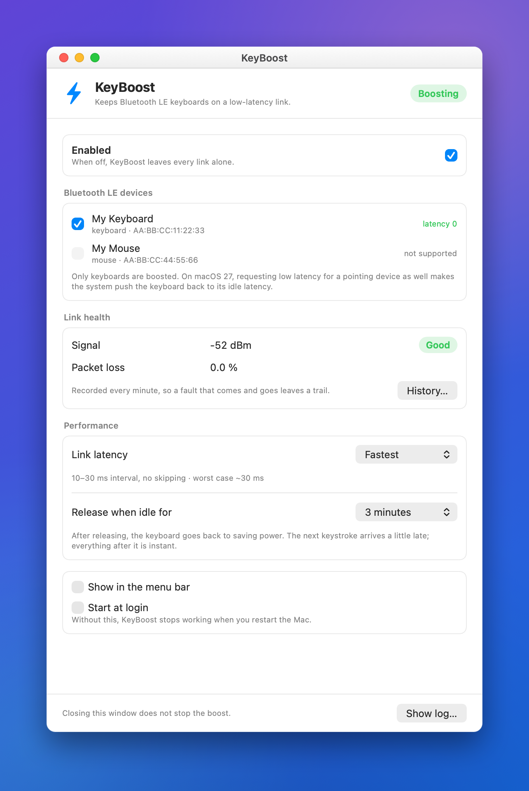

<p align="center">
  
</p>

<h1 align="center">KeyAwake</h1>

<p align="center">
  <a href="README.md">English</a> · <b>简体中文</b>
</p>

<p align="center">
  <b>修复 macOS 27 引入的蓝牙 LE 键盘延迟。</b><br>
  把链路最坏情况从 345 毫秒降到约 30 毫秒。
</p>

<p align="center">
  
  
  
</p>

---

<p align="center">
  
</p>

## 问题与修复

macOS 27 围绕 **LE Connection Subrating** 管理 LE 键盘：它下发 `peripheralLatency: 22` 的配置——两次按键之间最长 **345 毫秒**——再靠 subrating 抵消。在不支持蓝牙 5.3 的硬件上，subrating 请求会失败，延迟也没有任何机制回滚，键盘因此变得迟钝。macOS 里没有任何设置能修复它。

KeyAwake 是一个小的 CoreBluetooth 客户端，把连接保持在延迟 0。一段时间不输入后（默认 3 分钟）它会为省电释放链路，并在下一次按键时重新抓取——空闲后的第一次按键会稍晚到达。

**仅支持键盘。** 如果同时为指针设备请求低延迟，macOS 27.0.1 会把键盘推回空闲配置，因此指针设备交给 macOS 管理。

## 安装

下载最新 release，打开 `.dmg`，把 `KeyAwake.app` 拖进 Applications。然后勾选你的键盘并开启 **登录时启动**。

应用未公证，首次启动需要**右键 → 打开**。如果 macOS 仍然拦截：

```sh
xattr -dr com.apple.quarantine /Applications/KeyAwake.app
```

或者自行[构建](#构建)——用你自己的证书签名可以让 macOS 不再反复询问蓝牙权限。

## 权限

仅蓝牙，只需授权一次，且只给后台引擎。不申请辅助功能或输入监控：空闲检测使用 `CGEventSourceSecondsSinceLastEventType` 这个系统级空闲计数器，而非事件监听。项目中没有网络代码。

## 延迟级别

在 macOS 27.2 上实测，即 `bluetoothd` 实际协商的参数：

| 设置 | 间隔 | 外设延迟 | 最坏情况 |
|---|---|---|---|
| **最快**（默认） | 10–30 毫秒 | 0 | **约 30 毫秒** |
| 均衡 | 100–120 毫秒 | 1 | 约 240 毫秒 |
| 最低功耗 | 290–320 毫秒 | 1 | 约 640 毫秒 |

> **最低功耗比这个 bug 本身还慢**（345 毫秒）。选择时应用会给出警告。

## 排障

应用每分钟把信号强度、丢包和无线电断开记录到 `~/Library/Application Support/KeyAwake/link-history.csv`，窗口里会显示当前读数。

| 现象 | 可能原因 |
|---|---|
| 一小时内无线电断开很多次 | Mac 反复休眠并重启蓝牙——检查 `pmset -g custom`。 |
| 丢包高但信号不错 | 附近有 2.4 GHz 干扰。 |
| 信号弱（低于 −70 dBm） | 距离过远或有遮挡。 |
| 三项都正常，仍然慢 | 问题不在链路——与内置键盘对比一下。 |

## 工作原理

`KeyAwake.app` 是界面；作为登录项嵌套其中的 `KeyAwakeAgent.app` 是持续运行的引擎。设备按**硬件地址**而非 CoreBluetooth UUID 记住，重新配对不会破坏设置。

设计说明、私有 API 与注意事项：**[docs/DESIGN.md](docs/DESIGN.md)**。

## 构建

需要 Xcode Command Line Tools。

```sh
git clone https://github.com/sunven/key-awake.git
cd key-awake
./build.sh
```

`build.sh` 会在有可用签名身份时使用它，否则回退到 ad-hoc。

## 卸载

```sh
launchctl bootout gui/$(id -u)/com.keyawake.agent
rm -f ~/Library/LaunchAgents/com.keyawake.agent.plist
rm -rf /Applications/KeyAwake.app ~/Library/Application\ Support/KeyAwake
```

## 注意事项

- **使用私有 CoreBluetooth API。** 公开途径无法做到；每次调用都用 `responds(to:)` 保护，未来 macOS 移除这些 API 时 KeyAwake 只会失效，不会崩溃。
- **为 macOS 27 构建。** 更早版本不存在这个 bug。
- **未公证。** 见[安装](#安装)。

## 参与贡献

翻译是最简单的贡献方式：把 `Resources/en.lproj/Localizable.strings` 复制到新的 `<language>.lproj`，翻译右侧内容，并把语言代码加入 `build.sh` 的 `CFBundleLocalizations`。应用目前提供英语、西班牙语和简体中文。

## 致谢

本项目是 [Leonardo Fundora](https://github.com/leonardofundora) 的 [KeyBoost](https://github.com/leonardofundora/KeyBoost) 的重写版本；原项目确立了该 bug 的诊断与 CoreBluetooth 变通方案。原始版权声明予以保留。

## 许可证

MIT — 见 [LICENSE](LICENSE)。包含来自 KeyBoost 的代码，其原始版权声明（© Leonardo Fundora）予以保留。
